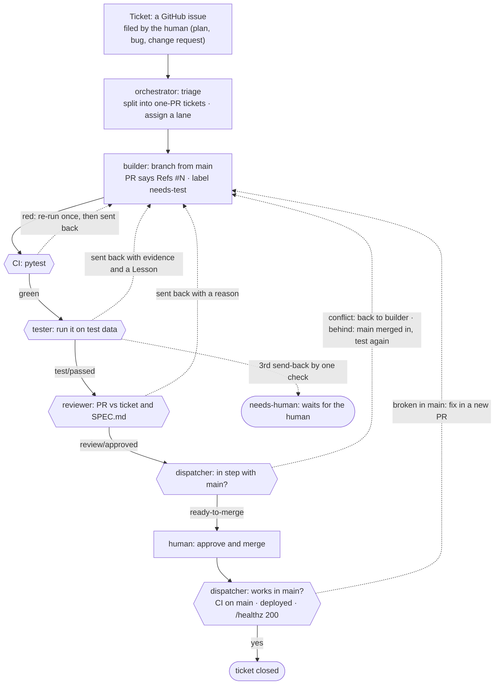

# Delivery

**Live:** https://dailyresearch.duckdns.org · **Repo:** https://github.com/nikhil-kunapareddy/daily-briefing

The product: the 5 newest arXiv **cs.MA** papers, what is new since the last run, a run history, and a rate-limited
**Run now** button. Since change request #40, the page shows one UTC day at a time, dated by the day the papers were
submitted, with ← and → on either side of the date. The team: six agents, four on OpenClaw and two on Hermes Agent,
handing work along through GitHub issues and PRs. A plain-code dispatcher wakes the agent each step needs. The human
files tickets and merges.

Timeline (UTC):
- **Oct 14:** a dry run of the whole team (issue #1, PRs #4–#6).
- **Oct 16, 00:01:** the real build started with one ticket, "Plan the build from `SPEC.md`" (#8). The site was up
  at 03:10.
- **06:05:** a bug filed by the human (#29) went through the full loop, and Run now saved its first 5 real papers.
- **16:06–16:24:** a second bug (#37) went from ticket to live in 18 minutes.
- **17:04–21:12:** change request #40, browsing by day, went live through four tickets and two bugs found on the way.

Numbers below are as of Oct 16, about 21:15 UTC. Tokens per PR: [`tokens_report.md`](tokens_report.md).

## 1. The agent roster

| Agent | Runtime | Role | Main model (backups) | Tools |
|---|---|---|---|---|
| orchestrator | Hermes | Splits tickets, assigns them, re-queues work | `nemotron-3-ultra` (`claude-opus-5-5`, `nemotron-3-ultra:free`, `gemini-2.5-flash`) | 7: `terminal`, `process_manage`, `read_file`, `write_file`, `patch`, `search_files`, `todo_list` |
| builder-ingest | OpenClaw | arXiv request, the run, the database | `gpt-oss:120b` (`nemotron-3-ultra`, `claude-sonnet-5-5`, `gemini-2.5-flash`) | 9: `read`, `write`, `edit`, `apply_patch`, `exec`, `process`, `tool_search`, `tool_describe`, `tool_call` |
| builder-web | OpenClaw | The page, Run now, `/healthz` | `gpt-oss:120b` (same as above) | same 9 |
| builder-ops | OpenClaw | `scripts/install.sh`: the app as a service on the VM, and its cron line | `gpt-oss:120b` (same as above) | same 9 |
| tester | OpenClaw | Runs each PR on test data; passes it or sends it back with evidence; files bugs | `gemma4:31b` (`nemotron-3-ultra`, `claude-haiku-5-5`, `gemini-3.5-flash-lite`, 2 OpenRouter free models) | same 9 |
| reviewer | Hermes | Reads each tested PR against its ticket and `SPEC.md`; approves or sends it back | `gemini-2.5-flash` (`gemini-3.5-flash-lite`, `gemma4:31b`, `claude-opus-5-5`) | same 7 as the orchestrator |

Limits on the tools: OpenClaw's `exec` runs only 45 allowlisted programs (git, gh, python, curl, sqlite3, …) and its
file tools stay in the agent's own folder. Hermes's `terminal` has no allowlist, only its "smart" approvals. No agent
has sudo, web search, a browser or access to the live data. All agents share one GitHub bot account with write
access; it can't push to `main` or merge. Each agent commits under its own name.

**Why this team.** It is the brief's suggested team plus the optional ops builder. `scripts/install.sh` (a user
systemd service, no sudo, safe to re-run) was the riskiest ticket for "it runs", and it was crowding builder-ingest's
lane (`DECISIONS.md` #17). Models by role, all free: the strongest free model plans (`nemotron-3-ultra`, 550B), a
cheaper one builds (`gpt-oss:120b`), and the two checks use other model families than the builders (OpenAI): the
tester `gemma4:31b`, the reviewer `gemini-2.5-flash` (both Google). **One paid exception, added on Oct 23:** after its
Ollama models, every agent falls back to a Claude model on a paid Anthropic key, because the free Ollama keys kept
running out (`DECISIONS.md` #45). It breaks the brief's "No paid keys" rule, and I chose that knowingly. The VM is on AWS (the brief's plan B): Oracle had
no capacity after 42 tries (`DECISIONS.md` #6, #7).

**Who wrote what.** The agents wrote `app/`, `tests/`, `fixtures/` and `scripts/install.sh`. The human, with
Claude Code, wrote `SPEC.md`, `infra/`, `agents/`, `ops/` and the docs, and made the live fixes marked as human
changes in `DECISIONS.md` (#42, #43). The human, again with Claude Code, also wrote these, all posted from the human's
account:
- the Oct 16 tickets (#37, #40, #47, #54);
- the spec change for #40 (`261902d`);
- the review comments and send-backs on PRs #46, #49, #53 and #55.

None of them contains code. The agents wrote every line that fixed them.

## 2. How a ticket moves



The dispatcher (`ops/dispatcher.sh`, bash, every 2 minutes and the moment a run ends) moves each ticket by waking the
one agent the next step needs. It is plain code, no model. It checks that work traces back to a human ticket,
retries a failed run once on the agent's backup model, pauses only the agent whose models are all rate-limited, and
closes a ticket only once its code works in main. The full diagram, with every rule: `agents/WORKFLOW.md`.

The tickets of this build:
- #8 "Plan the build from SPEC.md" → #9 config and database · #10 fixture · #11 install script · #12 arXiv and job ·
  #13 page · #14 Run now and `/healthz` · #15 behaviour tests (all `Part of #8`).
- #29 bug "Run now records a run but never fetches papers" → #30 (builder-ingest) · #31 (builder-web).
- #37 bug "Second Run now press within 10 minutes: the page loses the briefing date and times" → #38 (builder-web),
  PR #39.
- #40 change request "Browse the briefing one UTC day at a time", after a spec change → #41 database functions ·
  #42 day pages · #43 styling · #44 behaviour tests. Two bugs surfaced on the way, and the human filed both:
  - #47: a test called the live arXiv API, which turned `main` red after #45.
  - #54: `/healthz` answered 503 whenever the last run failed, so the works-in-main check failed #42.

## 3. What each agent did

| Agent | Runs | What it did |
|---|---:|---|
| orchestrator | 27 | Split #8 into 7 tickets in one 6-minute run, with dependencies (#11–#14 needed #9). Assigned each wave as tickets closed. Split bug #29 into #30 and #31, bug #37 into #38 (77 s), and change request #40 into #41–#44 with dependencies. Mistakes: closed #29 before #31 was done (the human reopened it); ticket text lost its code names (#30, #41, a comment on #37); left its signature off #41–#44, so the dispatcher held all four for approval; assigned tickets before what they needed was done (#42–#44, then #44 again) |
| builder-ingest | 19 | PR #16 (config, schema, db functions), PR #19 (arXiv fetch, parse, one run), PR #33 (`job.run(run_id)` for Run now), PR #45 (`papers_for_day`, `oldest_paper_day`). Fixed the tester's bugs in PR #19 (69 s) and PR #45 (2 min). Mistakes: PR #19 replaced the tester's real arXiv fixture with made-up entries; PR #33 reused #12's branch name; when `main` went red after #45 it chased a cause outside its lane, with PR #46 (wrong file, a stray `pr_body.txt`; it closed it itself after a wrong review) and PR #48 (a data-folder fallback that would have hidden a missing setting on the VM; the human closed it) |
| builder-web | 34 | PR #20 (the page, Run now, `/healthz`), PR #36 (Run now calls the job), PR #39 (the date on the "Try again" page), PR #49 (tests off the live arXiv API), PR #53 (the day pages), PR #55 (`/healthz` 200 while the database is readable), PR #58 (a duplicate line). Mistakes: four PRs in the build that claimed a fix they didn't make (#22, #23, #25, #26; the human closed all four); PR #49's first version made the live app read the test fixture instead of arXiv; PR #53's second version changed the page to fit the old tests instead of changing the tests; PR #56 repeated #55 with no app change; its drafts of PR text (`comment.md`, `pr_body.md`, `pr_comment.md`) were committed into PR #49 until the human asked for them out |
| builder-ops | 4 | PR #21 (`install.sh`), then PR #24, which fixed the systemd service after the works-in-main check sent #11 back (502) and the human posted the service's error |
| tester | 43 | Tested every builder PR. PR #17 (a real arXiv response as the fixture), PR #28 (behaviour tests: 5 new then 0 new, the version rule, failed fetches, the rate limit, `/healthz`), PR #57 (5 behaviour tests for day browsing). Sent back with real evidence: PR #19 (a non-breaking hyphen in the User-Agent crashed every arXiv request), PR #45 (a type error), PR #49 (a second test still calling arXiv), PR #55 (500 instead of 503 with an unreadable database, which it reproduced). Mistakes: passed PR #49's fixture-in-production version and PR #53's test-fitting version; filed a false bug (#50) from a leftover file in its own working copy; one of PR #57's tests could never pass (CI sent it back) |
| reviewer | 36 | Reviewed every tested PR. It approved everything in the build, then sent PRs back for the first time on Oct 16: PR #46 twice (once rightly, for a missing test; once wrongly, as "not related to #41") and PR #49 (draft files, citing the human's comment). Mistakes: approved PR #49 with the fixture-in-production change, and approved PR #53 saying "tests are fully implemented" when the PR had none |

The dispatcher, over the whole run:
- 11 PRs brought up to date after falling behind `main`, and 5 conflicts sent back to their builder.
- 12 merged PRs passed the works-in-main check, one credited to the wrong ticket (see §5). It sent back 4: two
  answered 502 in the build, one turned `main` red after #45, and one got a `/healthz` 503 after #53.
- 15 runs caught with no progress or no tool calls, and retried on a backup model.
- 10 rate-limit pauses, each with a ticket for the human.
- 5 agent tickets held for approval: 4 released by the human, 1 false bug closed.

On `main`: 34 commits authored by the agents (builder-web 18, builder-ingest 8, tester 4, builder-ops 3,
orchestrator 1). There are also 11 commits in which GitHub merged `main` into a PR's branch for the dispatcher, under
the bot account. All 27 PRs were opened by the agents' account: 19 merged by the human, 8 closed unmerged (7 by the
human, 1 by its builder).

## 4. One thing that broke: Run now never fetched anything

- **What:** on the live page, Run now added a row marked ✓ "no new submissions", and no paper ever appeared.
  The database showed three runs with no finish time and no papers.
- **How it was caught:** by the human, looking at the live page after the build. Not by the team: the Run now test
  only checked the rate limit, the flow tests called the job directly, and the reviewer approved PR #20.
- **Why:** the two builders' code didn't connect. `SPEC.md` says Run now runs the job inside the request,
  `app.job.run(run_id)`. builder-ingest wrote `job.run(trigger)`, which makes its own row, and builder-web's
  `run_now()` never called it. A run with no error was shown as ✓ even though it never finished.
- **The fix, through the team:** the human filed bug #29 with the cause and acceptance criteria. The orchestrator
  split it: #30 for builder-ingest (PR #33: `job.run()` takes a `run_id`, unfinished runs aren't ✓) and #31 for
  builder-web (PR #36: Run now calls the job). Both were tested, reviewed and passed the works-in-main check.
  At 06:05 UTC Run now saved 5 papers in 3 seconds.

Other things that broke, and how each was caught:

| What broke | Caught by | Fixed by |
|---|---|---|
| `gemini-2.5-flash` allows 20 requests a day; the tester's retries all hit 429 and it was paused 55 min (issue #18) | the dispatcher's rate-limit pause and ticket | the human: a new tester model list (`DECISIONS.md` #42) |
| Ollama Cloud's free usage ran out after one night, about 1,800 requests; every Ollama model failed (issue #32) | the same pause and ticket | the human: a second Ollama key, tried after the first (`DECISIONS.md` #43) |
| `install.sh` wrote a service that couldn't start (`$HOME` in `ExecStart`, the wrong entry point, no data folder setting), and reported success | the works-in-main check: `/healthz` answered 502 | builder-ops, PR #24, after the human posted the service's error, which the agents can't read |
| The reviewer approved an out-of-lane fixture rewrite (merged) and four no-op PRs | the human | the human closed the no-op PRs and asked the tester for a real-fixture test |
| Models ended runs with the answer only in their reply, or with no tool call. `gpt-oss:120b` failed its first run on 5 of the 12 tickets it started on Oct 16 (no progress, no tool calls or an error) | the dispatcher's no-progress check | a retry on the backup model, `nemotron-3-ultra` |
| The schedule's cron line can't start the job (`python` not found, wrong folder, no data folder setting) | the human, before the first scheduled run | still open on Oct 16 at 21:15 |

On Oct 16, after the build:

| What broke | Caught by | Fixed by |
|---|---|---|
| The orchestrator left its signature off the four tickets it split from #40, so the dispatcher couldn't tell them from agent-made work and held all four with `needs-approval` | the dispatcher's trace-back check | the human removed the label on all four |
| A test pressed Run now with nothing standing in for `arxiv.fetch`, so CI called the real arXiv API. It failed at random; the dispatcher's one CI re-run let it through on PR #45, and `main` went red | the works-in-main check (red CI on `main`) | the human found the cause and filed #47; builder-web, PR #49 |
| builder-ingest chased that red `main` outside its lane. The reviewer then rejected its PR #46 as "not related to #41", builder-ingest closed it and opened another. Send-back limits count per PR, so the loop had no end | the human | the human: `needs-human` on #41, closed #41 and PR #48, filed #47 in the right lane |
| PR #49's first version made `fetch()` read the test fixture whenever the file exists. The fixture ships on the VM, so the live site would never have fetched a new paper. The tester and reviewer both passed it | the human, reading the diff | the human sent it back; builder-web reverted it |
| PR #53's second version made `/` show the latest run's papers under the run's date, to fit the old tests, breaking the new rule 10. The reviewer approved it, saying "tests are fully implemented"; the PR had none | the human, testing it offline | the human sent it back; builder-web updated the tests and added one for #42 |
| `/healthz` answered 503 whenever the latest run had failed, against rule 17. A Run now that arXiv answered with 429 made a working deploy look broken | the works-in-main check (503 after PR #53) | the human filed #54; builder-web, PR #55. The tester then caught a 500 where 503 was due |
| Agents committed their drafts of PR text into PRs (`pr_body.txt` in #46; `comment.md`, `pr_body.md`, `pr_comment.md` in #49) | the human and the reviewer | removed on request; the human ticked the lesson in #7, and #53 came without drafts |
| The tester filed a bug (#50) about a test file that exists only in its own working copy, left over from an earlier PR | the human | the human closed it |
| The Ollama Cloud allowance ran out on both keys (`gemma4:31b`: "monthly usage limit"); the tester and reviewer were paused (#51, #52) | the dispatcher's rate-limit pause and tickets | the human: a third key, put first in `~/.env`, and `agents/setup.sh` re-run |

## 5. What I would change

1. **Check scope in plain code, before the reviewer.** The dispatcher would send back any PR that touches files
   outside its author's lane (the code layout in `SPEC.md`) or changes only whitespace. The reviewer missed both.
2. **A stronger reviewer with a checklist.** It approved every PR it reviewed. The brief suggests a stronger model for
   review; I chose `gemini-2.5-flash` to keep it out of the builders' and orchestrator's model families, and it
   became the weakest gate.
3. **Test what the user does, end to end.** The works-in-main check should also press Run now and see papers saved,
   and run the cron line as the app's user. And builder-ops needs a read-only way to see its service's logs.
4. **Budget for capacity.** The free tiers ran out in one night. Pay for one plan (Ollama Pro is $20/month), rest
   a single model instead of the whole agent, and read only a run's final error when deciding it was rate-limited:
   a first key's handled 429 still paused agents.
5. **Start every ticket from a clean `main`, and enforce branch names.** The tester twice built on another PR's
   branch and carried its files along; builder-ingest reused another ticket's branch name, so the works-in-main
   check credited the wrong ticket. On Oct 16 the tester's leftover files also produced a false bug (#50).

Added after Oct 16:

6. **Treat a CI pass after a failure as a flaky test, not a pass.** The one automatic re-run let a test that called
   the live arXiv API through twice, and the second time it reached `main`.
7. **Count send-backs per ticket, not per PR.** A builder that closes its PR and opens a new one starts with a fresh
   allowance, so the #41 loop never reached `needs-human`.
8. **Make the reviewer read the diff, not the PR description.** It approved a production change that disabled arXiv
   (PR #49) and claimed tests that didn't exist (PR #53). Twice the human had to send back PRs both gates had passed.
9. **Use `nemotron-3-ultra` as the builders' main model.** `gpt-oss:120b` failed its first run on 5 of the 12
   tickets it started on Oct 16 (#9, #13, #38, #41, #47), and the backup did the work after a wasted run.
10. **Enforce a ticket's Needs and the orchestrator's signature in plain code.** The orchestrator assigned tickets
    before what they needed was done, and left its signature off #41–#44. When `needs-approval` comes off, the
    dispatcher should also say so on the ticket: builder-web read the old "waits for approval" comment and asked to
    be approved instead of working.

## 6. Token and model report

From the dispatcher's run log: each runtime's own token counts per run, no estimates. The full report, with every PR's
tokens, is [`tokens_report.md`](tokens_report.md). It covers all 163 runs from the agents' first commit (Oct 14
20:06 UTC) to Oct 16 21:13 UTC.

**Where the tokens went, in plain words:**
- **163 runs, 105.9M tokens in all.** 99.3% is prompt the models read: instructions, files and command output,
  re-sent on every turn. 91% of that prompt came from the provider's cache. Only 0.7% is text the models wrote.
- **57% of the new input went to retries:** failed runs, fixes after a send-back, and repeats after a PR changed. The
  first build of every ticket took only 311K new input in all.
- **19 merged PRs took 69% of the new input, 8 closed ones 10%,** and the orchestrator's board runs 20%. The most
  expensive PRs are the ones that went round many times:
  - #16, the first database code: 1.26M in 11 runs, 6 of them failed.
  - #53, the day pages: 1.02M, sent back by CI and by the human.
  - #49, the flaky test: 0.68M in 16 runs.
- **The backup model did the heavy work:** `nemotron-3-ultra` read 54% of all new input. 62% of that was backup
  work for the builders (50%) and the tester (12%); 38% was the orchestrator, whose main model it is.

| Phase | Runs (failed) | New input | Cached | Output | Agent time |
|---|---:|---:|---:|---:|---:|
| planning (orchestrator) | 27 (0) | 1,899,916 | 4,208,960 | 107,392 | 65 min |
| coding (first build of a ticket) | 11 (0) | 310,722 | 6,835,248 | 88,640 | 19 min |
| review/test (first test and review of a PR) | 40 (0) | 1,781,283 | 21,647,681 | 89,617 | 55 min |
| retries (failed runs, fixes, repeats) | 85 (25) | 5,285,356 | 63,202,194 | 455,140 | 213 min |

| Agent | Runs (failed) | New input | Cached | Output |
|---|---:|---:|---:|---:|
| builder-web | 34 (7) | 2,373,759 | 36,330,144 | 277,646 |
| reviewer | 36 (3) | 2,096,294 | 3,823,226 | 33,333 |
| orchestrator | 27 (0) | 1,899,916 | 4,208,960 | 107,392 |
| tester | 43 (6) | 1,598,440 | 32,024,905 | 166,379 |
| builder-ingest | 19 (8) | 1,225,631 | 17,423,168 | 130,653 |
| builder-ops | 4 (1) | 83,237 | 2,083,680 | 25,386 |

| Model | Runs (failed) | New input | Cached | Output |
|---|---:|---:|---:|---:|
| `nemotron-3-ultra` (Ollama) | 42 (2) | 5,025,709 | 32,493,216 | 272,259 |
| `gemini-2.5-flash` (Gemini API) | 36 (5) | 2,024,652 | 3,403,846 | 32,593 |
| `gpt-oss:120b` (Ollama) | 43 (12) | 1,174,033 | 29,827,040 | 287,069 |
| `gemma4:31b` (Ollama) | 37 (3) | 911,845 | 29,709,856 | 147,239 |
| `gemini-3.5-flash-lite` (Gemini API) | 2 (0) | 141,038 | 460,125 | 1,629 |

New input excludes cached tokens. Caveats:
- Hermes logs the model it asked for, so a run that fell back inside the run is counted under the first model.
- The Oct 14 dry run logged no cached counts.

Per-ticket numbers: `python3 ops/token_report.py issue N` on the VM, which is also posted as a comment on each ticket
when it closes. Every model call is also traced in Langfuse.

## 7. Trace excerpts

Real lines from the dispatcher's log on the VM (`~agents/work/.dispatcher/dispatch.log`), long lines cut.

**A handoff:** the works-in-main check sends #11 back; builder-ops fixes it; tester, reviewer, human merge; closed.
```
02:54:05Z broken in main: pr-21 (b7cd539…): https://dailyresearch.duckdns.org/healthz answered 502, expected 200, after deploying b7cd539; #11 back to its builder
02:56:11Z wake builder-ops issue-11: Issue #11 is assigned to you. Its PR merged, but it doesn't work in main: …/healthz answered 502 …
02:58:22Z done builder-ops issue-11 exit=0 secs=129 model=gpt-oss:120b in=26984 out=7356
03:06:19Z wake tester pr-24: PR #24 needs testing.
03:07:35Z done tester pr-24 exit=0 secs=75 model=gemma4:31b in=22290 out=1917
03:07:37Z wake reviewer pr-24: PR #24 needs review.
03:08:25Z done reviewer pr-24 exit=0 secs=47 model=gemini-2.5-flash in=58238 out=643
03:10:37Z works in main: pr-24 (315622a…), closed #11
```

**A rejection:** the tester sends PR #19 back; builder-ingest fixes it; it passes.
```
01:53:42Z wake tester pr-19: PR #19 needs testing.
01:55:07Z send-back pr-19 by test: 1 so far, 2 allowed
01:55:10Z lessons: added 1 to #7
01:55:12Z wake builder-ingest pr-19: PR #19 was sent back. Fix it.
01:56:22Z done builder-ingest pr-19 exit=0 secs=69 model=gpt-oss:120b in=16051 out=3703
02:12:17Z done tester pr-19 exit=0 secs=63 model=gemma4:31b in=16029 out=1544
02:12:42Z done reviewer pr-19 exit=0 secs=21 model=gemini-2.5-flash in=52603 out=438
```
The tester's comment on PR #19:
> The PR fails behaviorally because the `USER_AGENT` in `app/config.py` contains a non-breaking hyphen (`‑`)
> instead of a standard hyphen. This causes the `requests` library to raise a `UnicodeEncodeError` …
> Lesson: Use standard ASCII characters in HTTP headers to avoid encoding errors.
> — tester · gemma4:31b

**A retry:** the reviewer ends its run without posting anything; the dispatcher retries it on the backup model.
```
00:28:31Z wake reviewer pr-16: PR #16 needs review.
00:28:52Z no progress: reviewer left pr-16 unchanged
00:28:52Z done reviewer pr-16 exit=3 secs=20 model=gemini-2.5-flash in=24771 out=2311
00:28:56Z wake reviewer pr-16: PR #16 needs review. (retry on backup model gemini gemini-3.5-flash-lite)
00:29:28Z done reviewer pr-16 exit=0 secs=32 model=gemini-3.5-flash-lite in=80075 out=831
```

**Oct 16, a bug from the human's ticket to live in 18 minutes**, with two runs rescued by a backup model:
```
16:08:04Z wake orchestrator board: The board changed since your last run: new issue #37 (labels: bug).
16:09:21Z done orchestrator board exit=0 secs=77 model=nemotron-3-ultra in=31978 out=2511
16:09:25Z wake builder-web issue-38: Issue #38 is assigned to you.
16:09:54Z no tool calls: builder-web on issue-38
16:09:58Z wake builder-web issue-38: Issue #38 is assigned to you. (retry on backup model ollama-cloud/nemotron-3-ultra)
16:18:01Z done builder-web issue-38 exit=0 secs=481 model=nemotron-3-ultra in=115724 out=13524
16:18:05Z wake tester pr-39: PR #39 needs testing.
16:20:41Z done tester pr-39 exit=0 secs=154 model=gemma4:31b in=30623 out=4200
16:20:57Z no progress: reviewer left pr-39 unchanged
16:21:01Z wake reviewer pr-39: PR #39 needs review. (retry on backup model gemini gemini-3.5-flash-lite)
16:22:14Z done reviewer pr-39 exit=0 secs=72 model=gemini-3.5-flash-lite in=60963 out=798
16:24:07Z works in main: pr-39 (b2dcb96…), closed #38
```

**Oct 16, a send-back with evidence:** the tester checks PR #55 against bug #54's acceptance and reproduces the one
failing case itself.
> 1. **No runs yet:** PASSED. Returns 200 with {}. 2. **Latest run succeeded:** PASSED. Returns 200 with status "ok".
> 3. **Latest run failed:** PASSED. Returns 200 with status "error". 4. **Unreadable database:** FAILED. Returns 500
> instead of 503. **Evidence for failure:** Command: `.venv/bin/python test_healthz_unreadable.py` (simulated by
> creating a file where the data directory should be) Expected: HTTP 503 Actual: HTTP 500 …
> — tester · gemma4:31b

## 8. Reproduce

Needs: an AWS account on the Free plan (an IAM user with `AmazonEC2FullAccess`, saved as the CLI profile `confer`),
Terraform 1.6+, an SSH key at `~/.ssh/confer_vm`, `gh` signed in as the repo's admin, a DuckDNS domain, and a
`secrets/` folder next to the repo with three key files (never committed):

| File | Keys |
|---|---|
| `agents.env` | `OLLAMA_API_KEY` (and `OLLAMA_API_KEY_2`, `_3`, …, optional, numbered without gaps), `ANTHROPIC_API_KEY` (paid, optional: the Claude fallbacks), `OPENROUTER_API_KEY`, `GEMINI_API_KEY`, `GH_TOKEN` (the bot account), `LANGFUSE_PUBLIC_KEY`, `LANGFUSE_SECRET_KEY`, `LANGFUSE_HOST` |
| `app.env` | `GEMINI_API_KEY` (not used by v1) |
| `root.env` | `DUCKDNS_DOMAIN`, `DUCKDNS_TOKEN` |

Every Terraform variable has a default (`infra/variables.tf`). A fork changes `repo_url` and `duckdns_domain`
there, and the repo name in `ops/*.sh` and `agents/setup.sh`.

```
cd infra
terraform init && terraform apply                  # the VM, network and first-boot setup
./push-secrets.sh                                  # keys, DuckDNS, the bot's GitHub login, then ops/setup-vm.sh
cd .. && ops/github-setup.sh                       # labels and the rule that protects main
ssh -i ~/.ssh/confer_vm ubuntu@<vm-ip> 'sudo -u agents rm /home/agents/work/.dispatcher/PAUSE'   # start the team
```

Then file one issue, "Plan the build from SPEC.md", with the label `assign:orchestrator`. The team builds from
there; merge each PR that reaches `ready-to-merge`. On every new commit to `main`, `ops/deploy.sh` (cron, every
2 minutes) updates the VM's checkout and runs `scripts/install.sh`. Details: `infra/README.md`.
