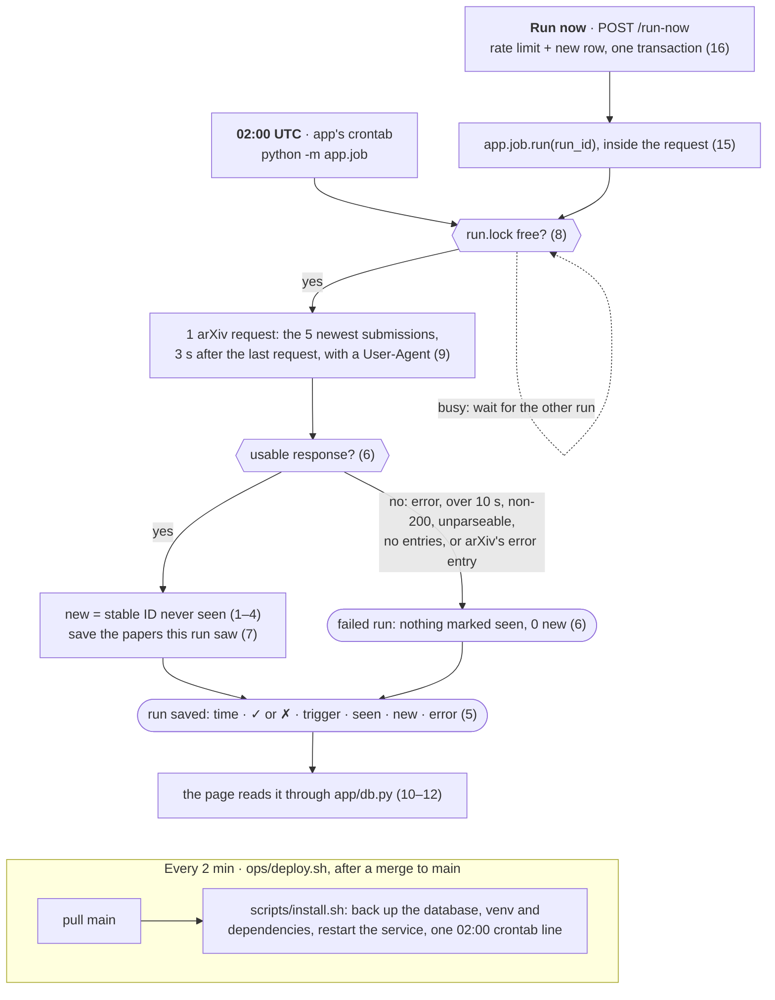

# Spec: Daily Briefing

What to build, written by the human. The orchestrator turns it into tickets; the tester and reviewer check work against it.
It says what must be true, not how to code it. This is v1, kept small on purpose; later features are change requests.

## Goal

A small public web app that, once a day, fetches the 5 newest submissions in arXiv's `cs.MA` category (multi-agent
systems), saves every run, and shows what is new since the last run.

- **Source:** the arXiv API, one request per run:
  `https://export.arxiv.org/api/query?search_query=cat:cs.MA&sortBy=submittedDate&sortOrder=descending&max_results=5`
  Sorted by submission date, so a new version of an old paper never takes a new paper's place.
- **Schedule:** every day at 02:00 UTC (after arXiv's evening announcement, with or without US daylight saving).
- **Public page:** the latest briefing at the top, the run history below. No login.
- **Run now:** a button on the page that starts a run, rate-limited.

**How a run works** (rule numbers in brackets). Both cron jobs are here: the app's 02:00 job, and the deploy check
that installs each merge.

## Stack

- **Python 3.12.** Dependencies pinned with exact versions in `requirements.txt`.
- **Flask** with Jinja templates, rendered on the server, served by **gunicorn**: 2 workers, a 60-second timeout,
  bound to `127.0.0.1:8000`, errors to `/var/log/daily-briefing/web.log`. Caddy already serves
  `https://dailyresearch.duckdns.org` and forwards to it.
- **SQLite** in WAL mode, foreign keys on. **No Docker**, no other database, nothing paid. The only outside call is the arXiv API.
- **Where it runs:** on the VM as the Linux user `app`, from the `main` checkout in `/srv/daily-briefing`.
  Data in `/var/lib/daily-briefing/` (it exists, owned by `app`), set by the environment variable `DAILY_BRIEFING_DATA`.
  Tests and test servers always point it at a temporary folder, never at the live one.
- **Install:** `scripts/install.sh` sets everything up; after every merge, `ops/deploy.sh` runs it as `app`.
  - Runs **without sudo**, and is safe to run again and again.
  - **Backs up the database first** (SQLite's online backup) into `/var/lib/daily-briefing/backups/`, newest 10 kept.
  - A virtualenv outside the checkout, in `app`'s home, with the dependencies from `requirements.txt`.
  - A **user systemd service** runs gunicorn and is restarted on each install. Lingering is on for `app`, and
    `XDG_RUNTIME_DIR` is set, so `systemctl --user` works from cron.
  - One line in **`app`'s crontab** runs `python -m app.job` at 02:00 UTC, its output added to
    `/var/log/daily-briefing/job.log`. Re-running the install doesn't add a second line.
- **Tests:** in `tests/`, run by `python -m pytest` from the repo root. CI runs them on every PR. Tests never call
  the real arXiv API: they use `fixtures/arxiv_sample.xml`, a real response to the query above (5 entries) with each
  entry's `
` and `<author>` cut out.

## Rules

**Finding what's new**
1. A paper's **stable ID** is its arXiv ID without the version: `2610.13870v2` → `2610.13870`.
2. A paper is **new** in a run when its stable ID was never seen in an earlier successful run.
   - A new version of a paper already seen (v2 after v1) is **not** new.
   - A later version of a paper never seen before (a v3 seen for the first time) **is** new.
   - On the very first run, everything is new, and the page says "First run: everything is new".
3. This comparison is plain code. No model decides anything.
4. Every paper the query returns counts, including ones cross-listed from another category.

**Saving runs**
5. **Every run is saved**, successful or not: start and finish time (UTC), ✓ or ✗, schedule or Run now, how many
   papers it saw, how many were new, and the error for a failed run.
6. A run **fails** when the request errors or takes over 10 seconds, arXiv answers with a non-200 status, the response
   can't be parsed, it contains **no entries** (arXiv sometimes sends a normal-looking response with no results), or
   its entry is arXiv's error entry (an `<id>` that starts with `https://arxiv.org/api/errors`). A failed run marks
   nothing as seen, and its new count is 0.
7. The database keeps which papers each run saw. **Nothing saved is ever deleted or rewritten**, and schema changes
   only add. Per paper, only: stable ID and version (from `<id>`), the title with line breaks and repeated spaces
   collapsed, the PDF link (`<link title="pdf">`), `<published>` and `<updated>`. Never its abstract or authors.
8. One run at a time: a run holds a lock file in the data folder, and a second run waits for it.

**Being polite to arXiv**
9. One request per run, and at most one request every 3 seconds. Send a `User-Agent` that names the app and links
   to this repo.

**The page** (`GET /`)
10. **Latest briefing** at the top: the date of the latest successful run ("Wed 14 Oct 2026"), then "N new since the
    last run" (or "First run: everything is new"), then the new papers, newest first, as a table:
    **S.No** (1, 2, 3…) · **Title** (plain text) · **DOI** (`10.48550/arXiv.<stable ID>`) · **PDF** (a link to the
    entry's `<link title="pdf">`).
11. **When nothing is new**, say so in one line, never as an empty table: "No new submissions since the last run
    (checked 14:32 UTC)." Under it, the briefing from the last run that did find papers, with its own date.
12. **Run history** below: the newest 10 runs, newest first, each with its time (UTC), ✓ or ✗, schedule or Run now,
    and the new count ("no new submissions" instead of 0). A failed row shows its error in short.
13. Readable on a phone; times in UTC and say so. One column, at most 760px wide, the system font, one stylesheet
    served by the app, no JavaScript, no CDN.
14. The footer says: "Thank you to arXiv for use of its open access interoperability." Nothing suggests arXiv endorses the app.

**Run now** (`POST /run-now`)
15. Runs the job with trigger "manual" (a few seconds) and goes back to the page, which shows the new row.
16. Rate limit: at most **one manual run every 10 minutes**, for everyone together, checked and recorded in one
    database transaction, so two presses at once can't both pass. Pressed too soon, the page says
    "Try again in N min" and no run starts.

**Health** (`GET /healthz`)
17. Answers `200` with JSON when the app can read its database: the latest run's time and status. Otherwise `503`.

## Code layout

Which files belong to which builder, so they can work at the same time without colliding. The orchestrator splits
the work along these lanes and takes each ticket's "Files likely touched" from this table.

| Path | Lane | What it holds |
|---|---|---|
| `app/__init__.py`, `app/config.py` | builder-ingest | The package, and the one place for settings (data folder, arXiv URL, User-Agent) |
| `app/db.py` | builder-ingest | The schema and **all** SQL, including the functions below |
| `app/arxiv.py`, `app/job.py` | builder-ingest | The request and parsing (rules 6–7); one run (rules 1–9); `python -m app.job` |
| `app/web.py`, `app/templates/`, `app/static/style.css` | builder-web | `create_app()`, the routes `/`, `POST /run-now`, `/healthz`, the page (rules 10–17) |
| `scripts/install.sh` | builder-ops | Install, backup, the service and the crontab line (Stack, Install) |
| `requirements.txt` | builder-ingest | Pinned dependencies. Another lane that needs a package asks in its PR |
| `tests/test_<module>.py` | that module's lane | Unit tests |
| `tests/test_behaviour_*.py`, `fixtures/` | tester | Behaviour tests and the saved arXiv response |

**Touch points between lanes** (fixed here; they don't change unless this spec does):
- The web side reads data **only** through `app/db.py`: `latest_briefing()`, `last_briefing_with_papers()`,
  `latest_runs(limit)`, `health()`. Each returns plain dicts and lists.
- Run now calls `start_manual_run()` in `app/db.py` (the rate-limit check and the new row, one transaction), which
  returns the run's id or how many minutes to wait, then `app.job.run(run_id)`. The schedule runs `python -m app.job`.
- The job writes **only** through `app/db.py`: `start_run(trigger)`, `save_papers(run_id, papers)`,
  `finish_run(run_id, error=None)`. Tests in any lane fill a test database only through these, never with their own SQL.
- gunicorn serves `app.web:create_app()`. Settings come from `app/config.py` only.

**A sensible order** (the orchestrator decides; Needs go by this):
1. builder-ingest: `config`, `db` with the schema and the functions above, `requirements.txt`.
2. tester: `fixtures/arxiv_sample.xml`. builder-ops: `scripts/install.sh` (needs only the names above).
3. builder-ingest: `arxiv` and `job` (needs 1). builder-web: the page and the history (needs 1).
4. builder-web: Run now, its rate limit, and `/healthz` (needs 3).
5. tester: behaviour tests across the lanes on the fixture: the job twice, the page, Run now (needs 3 and 4).

## Done when

1. `https://dailyresearch.duckdns.org` shows the latest briefing (the date, how many are new, and the table of
   S.No, Title, DOI and PDF) and the run history.
2. The history has at least 3 real runs, and one of them found no new submissions (Run now right after another run).
3. Run now adds a row. A second press within 10 minutes shows "Try again in N min" and adds no row.
4. The 02:00 UTC schedule is installed, and `scripts/install.sh` can be run twice in a row without errors or
   duplicates, leaving a database backup each time and never more than 10.
5. `python -m pytest` passes in CI, and the tests cover at least:
   - the same fixture run twice: the first run's page says "First run: everything is new", the second has 0 new;
   - the version rule: `…v1` then `…v2` is not new, a first-seen `…v3` is new;
   - a failed fetch, an empty response and arXiv's error entry are each saved as a failed run;
   - titles are saved with their whitespace collapsed;
   - the Run now rate limit, including two presses at once;
   - `/healthz`.
