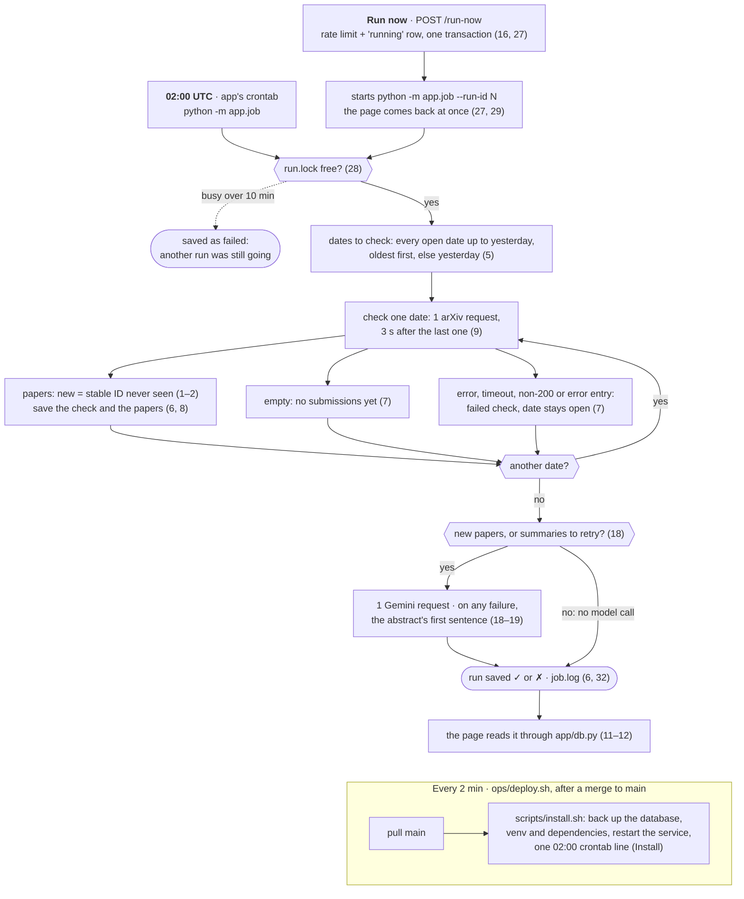
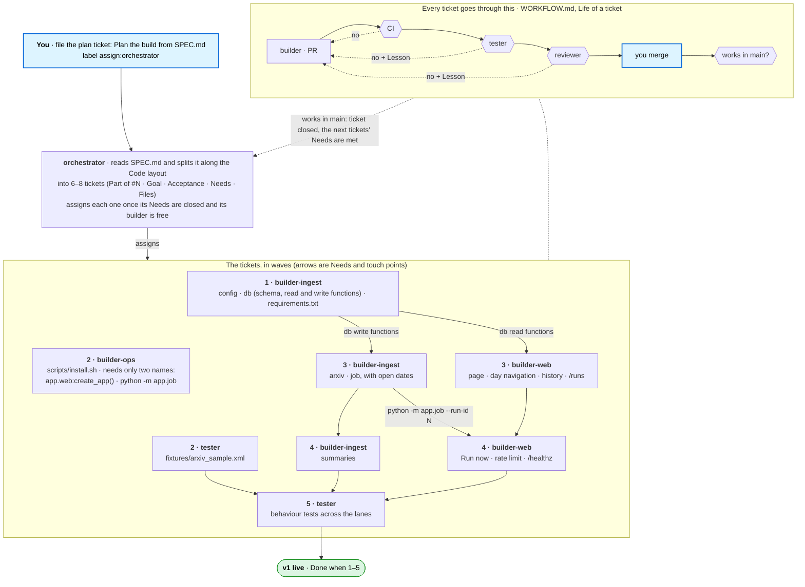

# Spec: Daily Briefing

What to build, written by the human. The orchestrator turns it into tickets; the tester and reviewer check work against it.
It says what must be true, not how to code it.

## Goal

A small public web app that, once a day, reads new papers in arXiv's `cs.MA` category (multi-agent systems),
saves every run, and shows a short briefing for each date: at most 5 papers, **from 2026-10-13 on**.

- **Source:** the arXiv API. For a date D (UTC, written `YYYYMMDD`), one request for D's 5 newest submissions:
  `https://export.arxiv.org/api/query?search_query=cat:cs.MA+AND+submittedDate:%5BD0000+TO+D2359%5D&sortBy=submittedDate&sortOrder=descending&max_results=5`
  For example D = `20261013`. Sorted by submission date, so a new version of an old paper never takes a new paper's place.
- **Schedule:** every day at 02:00 UTC (after arXiv's evening announcement, with or without US daylight saving).
- **Start:** the site covers every date from **2026-10-13**. The first run fills in all of them by itself.
- **Public page:** the latest briefing at the top, the run history below, and every earlier date's briefing one click away.
- **Run now:** a button on the page that starts a run, rate-limited.

**How a run works** (rule numbers in brackets). Both cron jobs are here: the app's 02:00 job, and the deploy check
that installs each merge.



## Stack

- **Python 3.12** (the VM's and CI's). Dependencies pinned with exact versions in `requirements.txt`.
- **Flask** with Jinja templates, rendered on the server, served by **gunicorn**. No JavaScript framework.
- **SQLite** in WAL mode, so the page can read while a run writes. Foreign keys switched on.
- **No Docker**, no other database, nothing paid. Two outside calls only: the arXiv API, and one Gemini API request
  per run for the summaries (free tier, rules 18–20).
- **Where it runs:** on the VM as the Linux user `app`, from the `main` checkout in `/srv/daily-briefing`.
  - The app listens on **`127.0.0.1:8000`**. Caddy already serves `https://dailyresearch.duckdns.org` and forwards to it.
  - Data lives in **`/var/lib/daily-briefing/`** (it exists, owned by `app`).
  - The data folder is set by the environment variable **`DAILY_BRIEFING_DATA`**, defaulting to `/var/lib/daily-briefing`.
    Tests and test servers always point it at a temporary folder, never at the live one.
- **Install:** `scripts/install.sh` sets everything up. After every merge, `ops/deploy.sh` runs it as `app`.
  - Runs as `app` **without sudo**, and is safe to run again and again.
  - **Before it changes anything, it backs up the database** (SQLite's online backup) into
    `/var/lib/daily-briefing/backups/`, keeping the newest 10. A bad change can then always be undone.
  - Python virtualenv outside the checkout (in `app`'s home), dependencies installed from `requirements.txt`.
  - A **user systemd service** runs gunicorn (settings: rule 31) and is restarted on each install, so new code goes live.
    Lingering is on for `app`, and `XDG_RUNTIME_DIR` is set, so `systemctl --user` works from cron.
  - A line in **`app`'s crontab** runs the job at 02:00 UTC: `python -m app.job`, its output added to
    `/var/log/daily-briefing/job.log`. Re-running the install doesn't add a second line.
- **Tests:** in `tests/`, run by `python -m pytest` from the repo root. CI runs them on every PR.
  - Tests never call the real arXiv API. Use the saved response in `fixtures/arxiv_sample.xml`: a real `cs.MA`
    response to the query above for D = `20261013` (5 entries), with each entry's `<summary>` (the abstract) and
    `<author>` elements cut out, so no agent reads them. A paper without an abstract simply gets no summary line.
  - Tests never call a model either: summaries come from a fake. A test that needs an abstract writes a short made-up one.

## Rules

**Finding what's new**
1. A paper's **stable ID** is its arXiv ID without the version: `2610.13870v2` → `2610.13870`.
2. A paper is **new** in a run when its stable ID was never seen in an earlier successful run.
   - A new version of a paper already seen (v2 after v1) is **not** new.
   - A later version of a paper never seen before (a v3 seen for the first time) **is** new.
   - On the very first run, everything is new, and the page says so (rule 21).
3. This comparison is plain code. No model decides what is new. The one model call writes summary sentences
   (rule 18) and nothing else: it never changes what is new, saved or shown.
4. Every paper the query returns counts, including ones cross-listed from another category.
5. **Dates.** A paper belongs to the date it was submitted (UTC). Each date shows at most 5 papers: the first 5 new
   ones found for it, newest submission first.
   - arXiv announces papers only on Sunday to Thursday evenings (US time), so a date's papers can arrive a day or two
     late (Friday's and the weekend's come on Monday or Tuesday). So a date stays **open** while it has fewer than
     5 papers and is less than 5 days old. A date never checked is open too, however old.
   - **Every run checks each open date up to yesterday, oldest first.** If no date is open, it checks yesterday.
     So the first run fills in every date from 2026-10-13, and a VM that was down catches up by itself.
   - Accepted: the rest of a busy day's papers (about a dozen more on a weekday; Oct 13 had 18) are never seen.
     That is the point: a short daily briefing.

**Saving runs**
6. **Every run is saved**, successful or not: start and finish time (UTC), success or failure, whether it came from the
   schedule or Run now, which dates it checked, how many papers it saw, how many were new, and the error for a
   failed run.
7. A **check of a date fails** when the request errors or times out, arXiv answers with a non-200 status, or the
   response can't be parsed. A failed check marks nothing as seen, and its date stays open. A run fails when any of
   its checks fails. An empty list is **not** a failure: arXiv has announced nothing for that date (yet).
   arXiv reports errors as an entry too, whose `<id>` starts with `https://arxiv.org/api/errors` (title "Error"):
   that is a failed check, never a paper. Its HTTP status is 400, but don't rely on the status alone.
8. The database keeps which papers each run saw, so any run's briefing can be rebuilt.
   **Nothing saved is ever deleted or rewritten**: not a run, not a paper, not the link between them. Schema changes
   only add tables or columns; they never drop, rename or rewrite existing ones.
   - **Per paper**, only: stable ID and version (both from `<id>`), title with line breaks and repeated spaces
     collapsed to one space, PDF link (`<link title="pdf">`), `<published>` and `<updated>` (UTC), its date (the
     UTC date of `<published>`), its abstract (`<summary>`, only to make the summary; never shown), and its summary
     with where it came from (rule 20). Never its authors or categories, and the app never downloads a PDF.
   - **Per check of a date:** the date, the result (papers, empty, or the error), and arXiv's
     `<opensearch:totalResults>` (how many papers that date has in all).

**Being polite to arXiv**
9. At most one arXiv request every 3 seconds, across schedule and Run now. One request per date checked.
10. Send a `User-Agent` that names the app and links to this repo.

**The page** (`GET /`)
11. **Latest briefing** at the top: the newest date that has papers, as a heading ("Tue 13 Oct 2026"), and its
    papers (at most 5, newest submission first) as a table with four columns and nothing else about a paper:
    - **S.No:** 1, 2, 3 …
    - **Title:** the paper's title, as plain text, and under it its summary sentence in smaller text, starting
      "AI summary:" or "From the abstract:" (rule 20).
    - **DOI:** arXiv's DOI for the paper, `10.48550/arXiv.<stable ID>` (arXiv registers one for every paper),
      for example `10.48550/arXiv.2610.13870`.
    - **PDF:** a link to the paper's PDF, the one the API gives for that entry (its `<link title="pdf">`).

    **No new papers is said plainly, never as an empty table:**
    - For each newer date without papers, one line above the briefing: "No new submissions for Fri 16 Oct yet.
      arXiv announces papers Sunday to Thursday evenings (US time)." while the date is open, and
      "No new submissions on Fri 16 Oct." once it isn't.
    - Under the heading, when the page was last checked: "Last checked 02:00 UTC". When that run found nothing new:
      "Last checked 14:32 UTC: no new submissions since the run before."
12. **Run history** below (how many: rule 23): one row per run, newest first, with the time (UTC), ✓ or ✗, schedule or Run now,
    the dates it checked, and the new count ("no new submissions" instead of 0). A failed row shows its error in short.
    Each date links to that date's briefing, `GET /?date=YYYY-MM-DD`: the same table, or its no-submissions line.
13. Readable on a phone. Times are shown in UTC and say so.
14. The footer says: "Thank you to arXiv for use of its open access interoperability." Nothing suggests arXiv endorses the app.

**Run now** (`POST /run-now`)
15. Starts a run with trigger "manual" and goes straight back to the page (rule 27), which shows the run in progress
    and then its new row.
16. Rate limit: at most **one manual run every 10 minutes**, and at most **20 manual runs per UTC day**, for everyone
    together, worked out from the saved runs. Pressed too soon, the page says "Try again in N min"; after the 20th
    of the day, "Run now is used up for today. The next run is at 02:00 UTC." Either way, no run starts.

**Health** (`GET /healthz`)
17. Answers `200` with JSON when the app can read its database: the latest run's time and status. Otherwise `503`.

**Summaries** (one model call per run)
18. After a run's checks, the job asks **`gemini-2.5-flash`** for one sentence per new paper, from its abstract only:
    what the paper does or finds, in plain words, at most 30 words, starting with the verb ("Proposes", "Shows",
    "Measures"), never with "This paper". **One request per run** for all its new papers
    (at most 25; any more wait for the next run), with a 30-second timeout. **A run with no new papers, and none
    waiting for a retry (rule 19), makes no model request at all**, so pressing Run now can't use up the allowance.
    The request: `POST https://generativelanguage.googleapis.com/v1beta/models/gemini-2.5-flash:generateContent`, with the key in
    the header `x-goog-api-key`, asking for JSON (`generationConfig.responseMimeType: application/json`) with thinking
    off (`generationConfig.thinkingConfig.thinkingBudget: 0`; with it on, a test call spent 286 thinking tokens on a
    48-token answer). The key is `GEMINI_API_KEY` in `/home/app/.env`: readable only by `app`, put there
    by the human's setup, never in the repo. The web service and the cron job both load it.
19. **A summary never breaks a run.** If the request fails or times out (quota errors, HTTP 402 or 429, included),
    the key is missing, or a sentence is missing or longer than 40 words, that paper shows its abstract's first
    sentence instead (at most 250 characters), and the run's result doesn't change. A paper without an AI summary is asked about again on the next 3 runs, then keeps
    the first sentence.
20. Each summary is saved with where it came from: the model's name, or "first sentence". The page labels it
    "AI summary:" or "From the abstract:", so nobody mistakes model text for the authors'.

**Page layout** (the human approved this look from a mockup; build it from these words, not from any HTML)
21. **Top to bottom**, and nothing else:

    ```
    Daily Briefing                                              [ Run now ]
    New papers in arXiv cs.MA (multi-agent systems),    At most once every 10 minutes
    every day at 02:00 UTC
    ───────────────────────────────────────────────────────────────────────
    [← Tue 13 Oct]          Go to [ 2026-10-14 ] [Go]          [Thu 15 Oct →]

    ▌No new submissions for Sat 17 Oct yet. arXiv announces …   (only if such a date exists, rule 11)

    Wed 14 Oct 2026                                    Back to the latest  (only on an older date)
    5 new · the newest of 17 submissions that day · Last checked 14:32 UTC: no new submissions since the run before.
    ┌──────┬────────────────────────────────────────────┬───────────────────────────┬─────┐
    │ S.NO │ TITLE                                      │ DOI                       │ PDF │
    │ 1    │ The Wealth of Agents: Scaling Agentic AI … │ 10.48550/arXiv.2610.20518 │ PDF │
    │      │ AI summary: Studies multi-developer …      │                           │     │
    └──────┴────────────────────────────────────────────┴───────────────────────────┴─────┘

    Run history
    All times UTC. Each date opens that day's briefing.
    TIME            ✓/✗   TRIGGER    DATES CHECKED            RESULT
    15 Oct, 14:32   ✓     Run now    Wed 14 Oct               no new submissions
    …the newest 10…                                                     All runs →
    ───────────────────────────────────────────────────────────────────────
    Thank you to arXiv for use of its open access interoperability. · Source: the arXiv API · /healthz
    ```
    The line under the heading says **how many papers are new** first: "5 new · the newest of 17 submissions that
    day" (17 is arXiv's `totalResults` for that date), then "Last checked …" on the latest date, or "Checked on
    15 Oct, 01:12 UTC" on an older one. **While the first run is the only run that found papers**, the line starts
    "First run: everything is new" instead of "5 new", and the first run's history row says "first run: everything
    is new".
22. **Moving between days.** "← <the day before>" and "<the day after> →" each step one day. They are greyed out and
    not links before 2026-10-13 and after yesterday. Between them, a date picker that is a plain GET form
    (`<input type="date" name="date">`, from 2026-10-13 to yesterday) with a Go button. `GET /?date=` with a date
    outside that range, or not a date, answers `404` with one line and a link to the latest briefing.
23. **Run history.** The main page shows the newest 10 runs, then "All runs →" to `GET /runs`: every run, 50 per page
    (`/runs?page=2`), with "← Newer" and "Older →". A date's page shows only the runs that checked that date.
24. **Narrow screens** (600px wide or less): the table's header row hides, and each paper's DOI and PDF link sit on
    one line under its summary. Each run history row becomes a small card: time, ✓/✗, trigger and dates on one line,
    the result under it. Nothing scrolls sideways.
25. **Style.** One column, at most 760px wide, 16px side margins. The system font. One stylesheet served by the app,
    `/static/style.css`; no JavaScript, no CDN, no web fonts, no images. Light or dark from the visitor's system
    setting. One accent colour for links and the Run now button; titles bold; the summary smaller and grey, its
    label ("AI summary:") in bold; DOIs in a monospace font; no-submissions, "Try again" and "used up for today" lines as a pale yellow
    note with a darker left border; ✓ green, ✗ red.
26. **Only the states that apply are shown.** No example, demo, legend or placeholder sections.

**Backend** (so it runs well on one small VM)
27. **Run now never runs inside the web request.** `POST /run-now` checks the rate limit (rule 16) and saves the new
    run as "running" in **one** database transaction (`BEGIN IMMEDIATE`), so two presses at once can't both pass. Then it
    starts `python -m app.job --run-id <id>` as its own process and goes straight back to the page. The scheduled
    run is the same command without `--run-id`.
28. **One run at a time.** A run holds a lock file, `run.lock` in the data folder, for its whole length. A run that
    finds it taken waits up to 10 minutes, then is saved as failed: "another run was still going". Because runs never
    overlap, the 3-second spacing (rule 9) holds: a run's first request comes at least 3 seconds after the last request
    saved in the database.
29. **A run in progress is visible.** While one is running, the page shows a note at the top, "A run is in progress
    (started 14:32 UTC).", and reloads itself every 10 seconds (`<meta http-equiv="refresh" content="10">`, not
    JavaScript) until it ends. Its history row says "running…". A run still marked running after 15 minutes counts
    as failed: "stopped without finishing".
30. **Database.** Each web request opens its own connection and closes it at the end; a run opens its own. Every
    connection sets `journal_mode=WAL`, `foreign_keys=ON` and `busy_timeout=5000`. A run writes in short transactions,
    one per check, so the page never waits on it. Indexes (or unique constraints) on: a paper's stable ID (unique),
    a paper's date, a run's start time, and a check's date and its run, so every page query stays fast as the
    history grows.
31. **gunicorn:** 2 workers, a 60-second timeout, bound to `127.0.0.1:8000`, errors to `/var/log/daily-briefing/web.log`,
    no access log.
32. **Logs** go to `/var/log/daily-briefing/` (owned by `app`; the agents and the deploy check can read it, unlike the
    service's own journal): `job.log`, one line per run start and end, per check and per summary request (never an
    abstract or a key), rotated at 5 MB with 3 old files kept; `web.log` (rule 31); and `deploy.log`, written by
    `ops/deploy.sh`. Request timeouts: arXiv 30 seconds, Gemini 30 seconds.

## Code layout

Which files belong to which builder, so the three can work at the same time without colliding. The orchestrator
splits the work along these lanes and takes each ticket's "Files likely touched" from this table.

| Path | Lane | What it holds |
|---|---|---|
| `app/__init__.py` | builder-ingest | Empty: makes `app` a package |
| `app/config.py` | builder-ingest | The one place for settings: data folder (`DAILY_BRIEFING_DATA`), start date 2026-10-13, arXiv URL and User-Agent, model name, timeouts |
| `app/db.py` | builder-ingest | The schema with its indexes, the connection settings (rule 30), and **all** SQL, including the functions below |
| `app/arxiv.py` | builder-ingest | The query for one date, the request, and parsing entries (rules 7 and 8) |
| `app/summaries.py` | builder-ingest | The one Gemini request per run and the first-sentence fallback (rules 18–20) |
| `app/job.py` | builder-ingest | One run: the lock, which dates are open, their checks, saving, then summaries (rules 2–9, 28); `python -m app.job [--run-id N]`; its log (rule 32) |
| `app/web.py` | builder-web | `create_app()` and the routes: `/`, `/?date=`, `/runs`, `POST /run-now`, `/healthz` |
| `app/templates/` | builder-web | Jinja templates: `base.html`, `index.html`, `runs.html`, `404.html` |
| `app/static/style.css` | builder-web | The one stylesheet (rule 25) |
| `scripts/install.sh` | builder-ops | Install, backup, the service and the crontab line (Stack, Install) |
| `requirements.txt` | builder-ingest | Pinned dependencies. Another lane that needs a package asks for it in its PR |
| `tests/test_<module>.py` | that module's lane | Unit tests, next to the code they test |
| `tests/test_behaviour_*.py`, `fixtures/` | tester | Behaviour tests and the saved arXiv response |

**Touch points between lanes** (fixed here, so nobody has to wait to learn a name):
- The web side reads data **only** through these functions in `app/db.py`, never with its own SQL. Each returns
  plain dicts and lists: `latest_date_with_papers()`, `briefing(date)` (the date's papers in order, `totalResults`,
  when it was last checked), `dates_without_papers(after)` (each with "open" or "closed"), `latest_runs(limit)`,
  `runs_page(page, per_page)`, `runs_for_date(date)`, `current_run()` (the run in progress, or none), `health()`.
- Run now calls `start_manual_run()` in `app/db.py`: the rate-limit check and the new "running" row in one
  transaction. It returns the new run's id, how many minutes to wait, or that today's 20 are used up. Then the web side starts
  `python -m app.job --run-id <id>` in its own process (rule 27). The schedule runs `python -m app.job`.
- gunicorn serves `app.web:create_app()` on `127.0.0.1:8000`.
- The job writes **only** through these functions in `app/db.py`: `start_run(trigger)` (returns the run's id),
  `save_check(run_id, date, result, total_results, papers)`, `save_summary(stable_id, text, source)` and
  `finish_run(run_id, error=None)`. Tests in any lane put data in a test database **only** through these same
  functions, never with SQL of their own; `app/db.py`'s own tests are the one exception.
- Settings come from `app/config.py` only.
- These names, their arguments and what they return don't change unless this spec changes. A lane that needs one
  more asks for it (WORKFLOW.md, "Needed by").

**How the agents build it.** You file one plan ticket; the orchestrator splits and assigns; every ticket then goes
through the same path (`agents/WORKFLOW.md`). The numbers are the waves of the order below.



**A sensible order** (the orchestrator decides; Needs go by this):
1. builder-ingest: `config`, `db` with the schema and the read functions, `requirements.txt`.
2. tester: `fixtures/arxiv_sample.xml` (no Needs). builder-ops: `scripts/install.sh` (needs only the names above).
3. builder-ingest: `arxiv` and `job`, with open dates (needs 1). builder-web: the page, day navigation, history and
   `/runs` (needs 1).
4. builder-ingest: `summaries` (needs 3). builder-web: Run now, its rate limit, and `/healthz` (needs 3).
5. tester: behaviour tests across the lanes, on the fixture: the job, then the page and `/?date=`, Run now and its
   rate limit, `/runs`, and the day arrows (needs 3 and 4). This is where the pieces are tested together.

## Done when

1. `https://dailyresearch.duckdns.org` shows the latest briefing (at most 5 papers, each with S.No, title and its
   summary, DOI and PDF link) and the run history, laid out as rules 21–26 say, and every date from 2026-10-13 has
   a briefing or a no-submissions line, reachable with the day arrows and the date picker.
2. The history has at least 3 real runs: the first checked every date from 2026-10-13, and one found no new
   submissions (Run now right after another run).
3. Run now goes straight back to the page, which shows the run in progress, then its row. A second press within
   10 minutes shows "Try again in N min" and adds no row.
4. The 02:00 UTC schedule is installed, and `scripts/install.sh` can be run twice in a row without errors or duplicates.
   Each run of it leaves a database backup, and never more than 10.
5. `python -m pytest` passes in CI, and the tests cover at least:
   - the same fixture run twice: the first run's page says "First run: everything is new"; the second run has 0 new,
     and the page says "no new submissions";
   - the version rule: `…v1` then `…v2` is not new, a first-seen `…v3` is new;
   - a failed fetch is saved as a failed run and its date stays open; an empty response is a successful check
     with no papers, shown as a no-submissions line;
   - open dates: with no runs yet, a run checks every date from 2026-10-13 to yesterday, oldest first, one request
     each and 3 s apart (tests use a fake clock and a fake sleep); a date with 5 papers, or 5 days old and checked,
     is not checked again;
   - each request asks for one date and 5 results, and a date shows at most 5 papers, each with S.No, title, DOI and
     PDF link;
   - an error entry (`<id>` under `https://arxiv.org/api/errors`) is a failed check, not a paper; titles are saved
     with their whitespace collapsed;
   - summaries: one model request per run covers all its new papers; the model's sentence shows as "AI summary:";
     a model error, a timeout or a missing key gives "From the abstract:" and the first sentence, the run still
     succeeds, and the paper is asked about again on the next run;
   - the Run now rate limit: 10 minutes between manual runs and 20 per UTC day, with the two messages;
   - a run with no new papers makes no model request;
   - `/healthz`;
   - Run now returns at once and starts the run in its own process (tests use a fake starter); two presses at the same
     moment start one run; two runs never overlap (the lock); a run still running after 15 minutes shows as failed;
     every connection has WAL, foreign keys and the busy timeout;
   - day navigation: the arrows stop at 2026-10-13 and at yesterday, and `/?date=` outside that range answers `404`;
   - run history: 10 runs on the main page, 50 per page on `/runs`, and a date's page lists only the runs that
     checked it.
