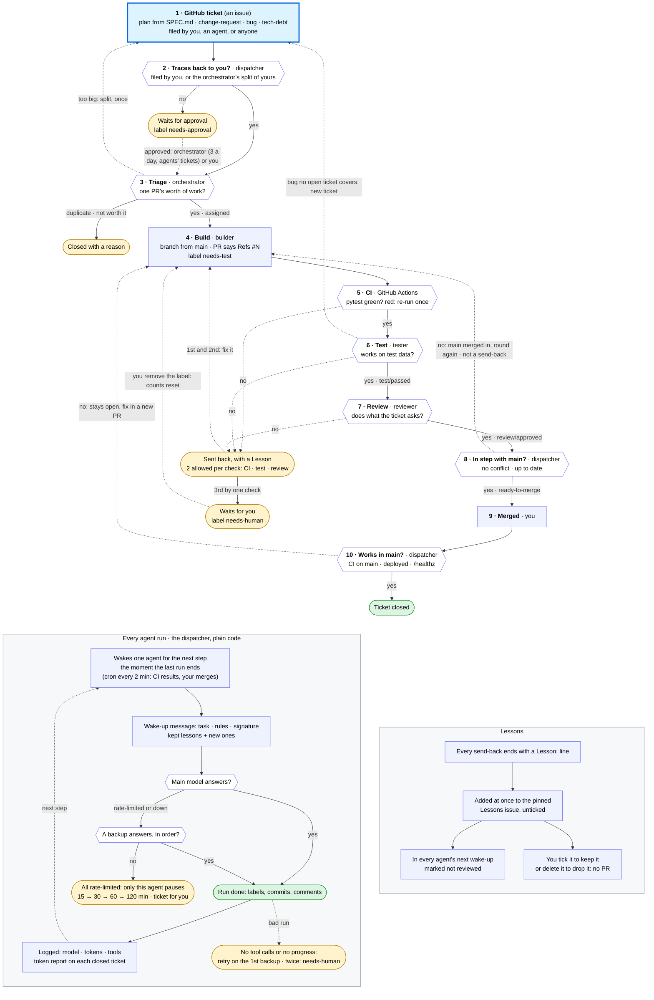

# Workflow

How work moves between the agents. Every agent follows these rules.
For humans, this is also the design of the team.

## Life of a ticket

All work starts as a ticket: a GitHub issue. A ticket ends when its code works in main, or closed with a reason.
Read it top to bottom. Solid arrows move the ticket forward; dashed arrows loop back to an earlier step.
Yellow means it waits (for you, or for another try); green means done. The two panels below the ticket's path
show what happens in every agent run, and how lessons spread.

1. **GitHub ticket.** The human files the plan ticket ("Plan the build from `SPEC.md`", label `assign:orchestrator`) and any
   `change-request`. The tester files `bug` tickets. Any agent may file `tech-debt`. Only the orchestrator assigns.
2. **Traces back to you?** Plain check by the dispatcher: a ticket the human filed, or the orchestrator's split of one
   (`Part of #N`), is work. Anything else gets `needs-approval` (rule 2). A ticket from the agents' account goes to the
   orchestrator, which may approve it if it fits `SPEC.md`, at most 3 a day; the rest, and every stranger's ticket,
   wait for the human.
3. **Triage** by the orchestrator. It splits a big ticket into tickets that each fit one PR (once: never a split of a
   split), and closes duplicates and ones not worth doing, with a reason. Every ticket gets Part of, Goal, Acceptance,
   Needs and Files likely touched. It adds `assign:<builder>` once the ticket's Needs are closed and that builder is free.
4. **Build** by the assigned builder: branch `<agent>/<issue>-<name>`, code and tests, its own pytest run,
   then a PR that starts `Refs #<issue>`, labelled `needs-test`. Builders work only in their lane's files and meet
   at the touch points named in `SPEC.md`'s Code layout. If a ticket needs something another lane hasn't built yet,
   the builder files `Needed by #N: …`, labels its ticket `blocked` and stops; the orchestrator gets the other
   lane to do it first.
5. **CI** runs pytest on the PR. If it's red, the dispatcher re-runs it once (in case it was a flake),
   then sends the PR back with no model call.
6. **Test** by the tester, against fixtures (CI already ran the whole suite). Pass: status `test/passed`, label
   `needs-review`. Fail: label `changes-requested`, with evidence and a `Lesson:` line. A bug this PR didn't cause goes
   to the open ticket (or open bug) that owns that code, as a comment; a new ticket only when none does.
   One ticket per piece of work: every failure on it (CI, test, review, works in main) stays on that ticket.
7. **Review** by the reviewer, against the ticket and `SPEC.md`. Approve: status `review/approved`, label `ready-to-merge`.
   Reject: label `changes-requested`, with the reason and a `Lesson:` line.
8. **In step with main?** Plain check by the dispatcher, at every step: a PR that conflicts with `main` goes back to
   its builder to merge `origin/main` in; one that fell behind gets `main` merged in by GitHub and is tested and
   reviewed again. Neither counts as a send-back. `main` only takes a PR that is up to date with it.
9. **Merged** by the human.
10. **Works in main?** Plain checks by the dispatcher on the merge commit: CI green on `main`, the VM deployed it
    (and `scripts/install.sh` worked, once it exists), and `/healthz` answers 200 (once the app has it).
    Pass: the dispatcher closes the ticket, and the orchestrator assigns the next one. Fail, or no result within
    30 minutes: the ticket stays open and its builder fixes it in a new PR. A ticket is done when it works in main,
    not when its PR merges.

A sent-back PR goes back to step 4 on the same branch. CI, test and review each have their own budget: the third
send-back by the same check gets `needs-human` instead (rule 5).
Cheap checks run first, so the strong reviewer model only sees code that already works.

No agent hands work to another directly. When an agent's run ends, the dispatcher reads the labels and wakes the one
agent the next step needs ("Who wakes when", below).

## Team

| Agent | Runtime | Model (family) | Job |
|---|---|---|---|
| orchestrator | Hermes | `nemotron-3-ultra` (NVIDIA) | Splits `SPEC.md` into issues, assigns them, triages bugs, re-queues stuck work |
| builder-ingest | OpenClaw | `gpt-oss:120b` (OpenAI) | Data side: schema, fetching, saving runs, finding new items, the job command |
| builder-web | OpenClaw | `gpt-oss:120b` (OpenAI) | Web side: public page, Run now, rate limit, health endpoint |
| builder-ops | OpenClaw | `gpt-oss:120b` (OpenAI) | Running it on the VM: install script, the web app's service, the schedule |
| tester | OpenClaw | `gemma4:31b` (Google) | Tests each PR branch. Passes it on, or sends it back with evidence. Files bugs |
| reviewer | Hermes | `gemini-2.5-flash` (Google) | Reads each tested PR against its issue and `SPEC.md`. Approves, or sends it back with a reason |

Most models are on free plans: Ollama Cloud for most agents, the Gemini API for the reviewer. Ollama has several keys:
`OLLAMA_API_KEY` first, then `OLLAMA_API_KEY_2`, `_3`, …, each tried while the ones before it are rate-limited
(DECISIONS #43, #44). Right after its Ollama models, every agent falls back to a Claude model on a paid Anthropic key
(`ANTHROPIC_API_KEY`), the one exception to the free stack (DECISIONS #45).
Neither check on a PR uses the builders' model family (OpenAI): the tester runs the code, the reviewer (Google) reads it.
The reviewer also differs from the orchestrator (NVIDIA), so it doesn't share the orchestrator's reading of the spec.

Models and fallbacks, used when a model is rate-limited or down:

| Agent | Main model | Backups, in order |
|---|---|---|
| orchestrator | `nemotron-3-ultra` (Ollama) | `claude-opus-5-5` (Anthropic) · `nemotron-3-ultra:free` (OpenRouter) · `gemini-2.5-flash` (Gemini API) |
| builder-ingest, builder-web, builder-ops | `gpt-oss:120b` (Ollama) | `nemotron-3-ultra` (Ollama) · `claude-sonnet-5-5` (Anthropic) · `gemini-2.5-flash` (Gemini API) |
| tester | `gemma4:31b` (Ollama) | `nemotron-3-ultra` (Ollama) · `claude-haiku-5-5` (Anthropic) · `gemini-3.5-flash-lite` (Gemini API) · `nemotron-3-ultra:free`, then `gemma-4-31b-it:free` (OpenRouter) |
| reviewer | `gemini-2.5-flash` (Gemini API) | `gemini-3.5-flash-lite` (Gemini API) · `gemma4:31b` (Ollama) · `claude-opus-5-5` (Anthropic) |

- Claude models follow the roles: the strongest (`claude-opus-5-5`) plans and reviews, a mid one builds, the cheapest tests (DECISIONS #45).
- After a failed run, the dispatcher retries it once on the **1st backup**. For the orchestrator that is `claude-opus-5-5`.
- The runtime falls back on its own (1st, then 2nd backup, and so on) when a model is rate-limited or down.
- The reviewer's first three models are Google. Only when it is on its last backup and the builder was on Claude does a PR
  get reviewed by the model family that wrote it.

Context window of each model: the most tokens one request can hold (prompt, files, history and the reply).
From each provider's API on 2026-10-15 (Ollama `/api/show`, OpenRouter `/models`, Gemini `models.get`); Claude from
Anthropic's model list on 2026-10-23.

| Model | Provider | Context window | Used by |
|---|---|---:|---|
| `gpt-oss:120b` | Ollama Cloud | 131,072 (128k) | builders (main) |
| `nemotron-3-ultra` | Ollama Cloud | 262,144 (256k) | orchestrator (main), builders and tester (1st backup) |
| `gemma4:31b` | Ollama Cloud | 262,144 (256k) | tester (main), reviewer (2nd backup) |
| `nemotron-3-ultra:free` | OpenRouter | 1,000,000 (1M) | orchestrator (2nd backup), tester (4th backup) |
| `gemma-4-31b-it:free` | OpenRouter | 262,144 (256k) | tester (5th backup) |
| `gemini-2.5-flash` | Gemini API | 1,048,576 (1M) | reviewer (main), orchestrator and builders (3rd backup) |
| `gemini-3.5-flash-lite` | Gemini API | 1,048,576 (1M) | reviewer (1st backup), tester (3rd backup) |
| `claude-opus-5-5` | Anthropic (paid) | 1M | orchestrator (1st backup), reviewer (3rd backup) |
| `claude-sonnet-5-5` | Anthropic (paid) | 1M | builders (2nd backup) |
| `claude-haiku-5-5` | Anthropic (paid) | 1M | tester (2nd backup) |

The tightest is `gpt-oss:120b`, the builders' main model, at 128k: keep reads to the files the ticket needs.

Tools each agent's model can call. Checked on 2026-10-15: OpenClaw's own list from one tiny run per config,
Hermes's from its toolsets (`terminal`, `file`, `todo`; every other toolset is off).

| Agent | Runtime | Tools | Count | Limits |
|---|---|---|---:|---|
| builder-ingest, builder-web, builder-ops, tester | OpenClaw | `read`, `write`, `edit`, `apply_patch`, `exec`, `process`, and Tool Search's `tool_search`, `tool_describe`, `tool_call` | 9 | `exec` runs only the 45 programs in `agents/openclaw/exec-allowlist.txt` (git, gh, python, curl, sqlite3, …). File tools stay inside the agent's own folder. The tool definitions add 5,348 characters to every prompt |
| orchestrator, reviewer | Hermes | `terminal`, `process_manage`, `read_file`, `write_file`, `patch`, `search_files`, `todo_list` | 7 | `terminal` has no allowlist: Hermes's "smart" approvals ask a second model about any command that looks risky and deny the dangerous ones. Both work in their own clone, kept on `main`. At most 60 turns a run (reviewer 40) |

For every agent: the Linux user `agents` has no sudo and can't read the live data. GitHub access is the one bot
account: write access, no admin, can't push to `main` or merge. No agent has web search, a browser, memory,
delegation or code-execution tools.

The dispatcher logs the model and token counts of every run (`runs.jsonl` on the VM).

## Labels

**Issues**

| Label | Meaning | Set by |
|---|---|---|
| `assign:<agent>` | This agent owns the issue | Orchestrator only |
| `bug`, `incident`, `tech-debt`, `change-request` | Kind of issue | Whoever files it |
| `needs-human` | Stuck. Waits for the human, who removes it to release the issue | Any agent, or the dispatcher |
| `blocked` | Waits for another lane's `Needed by #N` issue. Nobody works on it meanwhile | Its builder adds it; the orchestrator removes it |
| `needs-approval` | Not filed by the human or split from their ticket. Nobody works on it until it is approved (rule 2) | Dispatcher only |
| `rate-limit` | An agent can't reach any of its models. Not work: agents leave these issues alone | Dispatcher only |
| `lessons` | The pinned `Lessons` issue. Not work: only the human edits it | Setup (`ops/github-setup.sh`) |

**Pull requests.** A PR has exactly one of the first four at a time. Whoever adds one removes the previous one.

| Label | Meaning | Set by |
|---|---|---|
| `needs-test` | Waiting for the tester | Builder, when opening the PR or after a fix |
| `needs-review` | Tested. Waiting for the reviewer | Tester |
| `changes-requested` | Sent back to the builder | Tester, reviewer, or the dispatcher (red CI) |
| `ready-to-merge` | Approved. Waiting for the human | Reviewer |
| `needs-human` | Sent back too often, or an agent is stuck. The human removes it to release the PR | Any agent, or the dispatcher |

## Conventions

- **Branch:** `<agent>/<issue>-<short-name>`, for example `builder-ingest/3-new-items`. The dispatcher finds a PR's builder from this prefix.
- **PR body:** first line `Refs #<issue>`. Never `Closes`, `Fixes` or `Resolves`, in the body or in commits: the
  ticket closes when its code works in main (step 10), and the dispatcher rewrites those words to `Refs`. Then what changed, and how you tested it (paste pytest's summary line).
- **Commits:** author name is your agent name. End each message with two trailers: `Agent: <your name>` and `Model: <your model>`.
- **Signatures:** everything an agent writes on GitHub ends with one line naming the agent and its model:
  `— <agent> · <model>`, for example `— tester · gemma4:31b`. That means every PR body, issue and comment.
  The wake-up message gives your exact signature. If you know a fallback model answered instead, sign with that one.
  The dispatcher signs its own comments `— dispatcher · no model`.
- **Commit statuses** on the PR's latest commit: `test/passed` (tester) and `review/approved` (reviewer).
  A new push clears both, so every fix is tested and reviewed again. `main` only accepts a PR with both, plus green CI, merged by the human.
  A tester's own PR can't be tested by the tester: the dispatcher sets its `test/passed` to "not self-tested" and sends it to the reviewer.
- **Issues from the orchestrator** start with `Part of #N` (the ticket it split), then four parts: Goal, Acceptance
  (checkable bullets), Needs (`#n` or none), Files likely touched.

## Rules

1. **GitHub is the only channel.** Agents never call each other. Everything is an issue, a PR, a label, a comment or a status.
2. **Only the orchestrator assigns issues.** Other agents may file issues, but leave them unassigned.
   All work traces back to the human: a ticket the human filed, or the orchestrator's split of one (split once, never
   a split of a split). Every other ticket gets `needs-approval` from the dispatcher. Approving means removing that
   label: the orchestrator may do it for the agents' own tickets when the dispatcher asks, at most 3 a day; otherwise
   only the human. If the agents' account removes it at any other time, the dispatcher puts it back.
3. **Nobody checks their own work.** Builders never test, review or merge their own PRs. The tester and reviewer never change `app/`.
   The tester may write tests and fixtures in its own PRs; those skip the tester step and go straight to review.
4. **Every send-back ends with one line:** `Lesson: <one general rule>`, for example `Lesson: compare stable arXiv IDs, never titles.`
5. **Each check can send a PR back twice.** CI, test and review are counted separately. The third send-back by the
   same check gives the PR `needs-human`, and it waits for the human. The human releases it by removing the label,
   usually after a comment: all its counts start again from zero, and it re-enters at its pipeline label
   (`changes-requested`, so the builder tries again, unless the human swapped it for `needs-test` or `needs-review`).
6. **One open ticket per builder.** The orchestrator assigns a builder's next issue only after its previous PR is merged or closed,
   and never gives two builders issues that touch the same file at the same time.
7. **Stay in your lane.** Never push to `main`. Never change `.github/`, `infra/`, `ops/` or `agents/`.
   Never touch the live data in `/var/lib/daily-briefing/` or the live app on port 8000. Test servers use port 8100 or above.
8. **Keys stay secret.** Never print, paste or commit a key or token.
9. **Stuck or unsure:** comment on the issue or PR with what you tried and what you need, then add `needs-human`. Don't guess.
   **The human's word comes first:** a comment from the human (the repo owner, not signed by an agent) overrules
   any agent's comment on that issue or PR.
10. **Use your tools; never pretend.** Run every command with your tool. Never write a command or a tool call as text in your
    reply. Only report output a tool gave you, and quote it. The dispatcher counts a run with no tool calls as a failed run.
11. **Don't read papers.** The app handles IDs, titles and links, never a paper's content. Never open a paper's PDF
    or arXiv page, and never call the live arXiv API. Work from `fixtures/arxiv_sample.xml`, which has no abstracts or
    authors. The one exception is the tester making that file (its `SOUL.md`). Reading papers only spends tokens.

## Who wakes when

`ops/dispatcher.sh` runs with no model. It wakes at most one agent per run, under a lock, and caps each run at 20 minutes.
**Handoff:** when a run ends, the next one starts at once (up to 12 in a row), so the next step doesn't wait.
Cron also starts it every 2 minutes, for what no agent does: CI finishing, and the human's merges and labels. It checks from the end of the pipeline backward, so finished work moves first:

1. **reviewer:** the oldest PR with `needs-review` whose CI is green (the tester's own PRs come here straight, so CI is
   checked here too: red goes back, still running waits).
2. **tester:** the oldest PR with `needs-test` whose CI is green. Red CI: the dispatcher sends the PR back. Still running: wait.
3. **builder:** its oldest PR with `changes-requested`, otherwise its oldest `assign:<builder>` issue that has no open PR.
   An issue whose PR merged waits for the works-in-main check (step 10), unless the check failed: then it goes back to its builder.
   The tester is woken the same way for its own test-writing issues.
4. **orchestrator:** a ticket from an agent waiting for approval (each once, at most 3 approvals a day), then an issue
   with `assign:orchestrator` (it removes the label when done), or the board changed since its last run
   (a new or relabelled issue, a merged or closed PR).

Anything with `needs-human` is skipped. When nothing is waiting, no agent runs and no tokens are spent.
**Rate limits:** when a run fails because all of an agent's models are rate-limited, the dispatcher skips that agent
for 15, 30, 60, then 120 minutes between tries, and the other agents keep working. The item keeps its labels.
The dispatcher files one `rate-limit` issue for the human and closes it when the agent runs again.
The wake-up message names the issue or PR. The agent reads the details itself with `gh`.
**The dispatcher counts send-backs per check** (rule 5): red CI, the tester and the reviewer each get 2.
On the third send-back by the same check, it swaps `changes-requested` for `needs-human`. A red CI is re-run once per commit
before it counts, so a flaky test doesn't use up the budget.

## Commands

The repo is `nikhil-kunapareddy/daily-briefing`. `gh` is already signed in.

**OpenClaw agents (builders, tester): how `exec` runs commands.** It only runs allowlisted programs, one simple command
(or `&&` chain) at a time, and denies the whole command otherwise. So:
- **No redirections or heredocs:** no `>`, `>>`, `2>&1`, `<<EOF`. To write a file, use the `write` tool. To run a
  Python snippet, write it to a file with `write`, then run `.venv/bin/python that_file.py`.
- **No `$(…)` or backticks,** and **no `cd`**: your commands already run inside your clone.
- **`python3` or `.venv/bin/python`,** never plain `python` (it doesn't exist here).

| To | Run |
|---|---|
| Read an issue or PR with its comments | `gh issue view N --comments` · `gh pr view N --comments` |
| See a PR's changes | `gh pr diff N` |
| Check out a PR | `gh pr checkout N` |
| Run the tests (builders, tester) | `.venv/bin/python -m pytest -q` in your clone. The `.venv` is already there, with pytest |
| Install the dependencies | `.venv/bin/pip install -q -r requirements.txt` |
| Latest commit of a PR | `gh pr view N --json headRefOid -q .headRefOid` |
| Swap a label | `gh pr edit N --add-label needs-review --remove-label needs-test` |
| Post a status | `gh api repos/nikhil-kunapareddy/daily-briefing/statuses/SHA -f state=success -f context=test/passed -f description="…"` (`state=failure` to fail) |
| Comment (use a file for anything longer than a line) | `gh pr comment N --body-file note.md` · `gh issue comment N --body-file note.md` |
| Open a PR | `gh pr create --base main --title "…" --body-file pr.md --label needs-test` |
| File an issue | `gh issue create --title "…" --body-file issue.md --label bug` |
| Commit | `git commit -m "…" --trailer "Agent: <your name>" --trailer "Model: <your model>"` |

## Lessons

What the team has learned from send-backs, so the same mistake isn't made twice. No PR, no merge, no model.

1. The tester and reviewer end every send-back with a `Lesson:` line (rule 4).
2. The dispatcher adds each new one at once to the pinned GitHub issue `Lessons` (#7), as an unticked checklist item
   with a link to its comment. Only lines the agents' account posted count.
3. The human ticks a lesson to keep it, or deletes its line to drop it. Only the human edits the list: the dispatcher
   undoes any other edit by the agents' account.
4. Every agent's wake-up message carries the ticked lessons (the newest 20) and the newest 10 unticked ones, marked
   "not reviewed yet". Follow one of those only where it fits your task.
