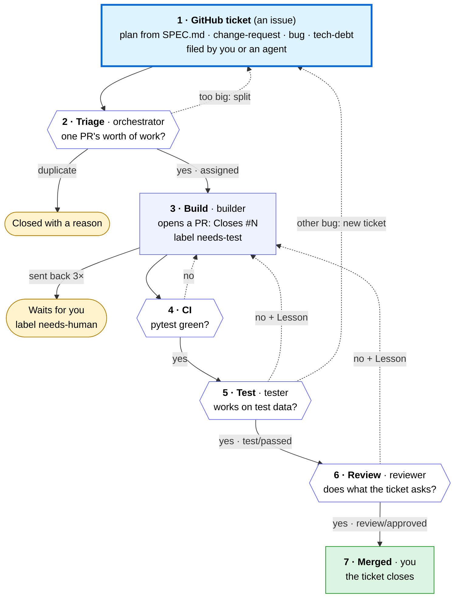

# Workflow

How work moves between the agents. Every agent follows these rules.
For humans, this is also the design of the team.

## Life of a ticket

All work starts as a ticket: a GitHub issue. A ticket ends as a merged PR, or closed with a reason.
Read it top to bottom. Solid arrows move the ticket forward; dashed arrows loop back to an earlier step.

1. **GitHub ticket.** The human files the plan ticket ("Plan the build from `SPEC.md`", label `assign:orchestrator`) and any
   `change-request`. The tester files `bug` tickets. Any agent may file `tech-debt`. Only the orchestrator assigns.
2. **Triage** by the orchestrator. It splits a big ticket into tickets that each fit one PR, and closes duplicates and
   ones not worth doing, with a reason. Every ticket gets Goal, Acceptance, Needs and Files likely touched.
   It adds `assign:<builder>` once the ticket's Needs are merged and that builder is free.
3. **Build** by the assigned builder: branch `<agent>/<issue>-<name>`, code and tests, its own pytest run,
   then a PR that starts `Closes #<issue>`, labelled `needs-test`.
4. **CI** runs pytest on the PR. If it's red, the dispatcher sends the PR back with no model call.
5. **Test** by the tester, against fixtures. Pass: status `test/passed`, label `needs-review`.
   Fail: label `changes-requested`, with evidence and a `Lesson:` line.
6. **Review** by the reviewer, against the ticket and `SPEC.md`. Approve: status `review/approved`, label `ready-to-merge`.
   Reject: label `changes-requested`, with the reason and a `Lesson:` line.
7. **Merged** by the human. The PR closes the ticket; the orchestrator sees the change and assigns the next ticket.

A sent-back PR goes back to step 3 on the same branch. The third send-back gets `needs-human` instead (rule 5).
Cheap checks run first, so the strong reviewer model only sees code that already works.

No agent hands work to another directly. Every 5 minutes the dispatcher reads the labels and wakes the one agent
the next step needs ("Who wakes when", below).

## Team

| Agent | Runtime | Model (family) | Job |
|---|---|---|---|
| orchestrator | Hermes | `nemotron-3-ultra` (NVIDIA) | Splits `SPEC.md` into issues, assigns them, triages bugs, re-queues stuck work, curates `LESSONS.md` |
| builder-ingest | OpenClaw | `gpt-oss:120b` (OpenAI) | Data side: schema, fetching, saving runs, finding new items, the job command |
| builder-web | OpenClaw | `gpt-oss:120b` (OpenAI) | Web side: public page, Run now, rate limit, health endpoint |
| builder-ops | OpenClaw | `gpt-oss:120b` (OpenAI) | Running it on the VM: install script, the web app's service, the schedule |
| tester | OpenClaw | `gemma4:31b` (Google) | Tests each PR branch. Passes it on, or sends it back with evidence. Files bugs |
| reviewer | Hermes | `gemini-2.5-flash` (Google) | Reads each tested PR against its issue and `SPEC.md`. Approves, or sends it back with a reason |

All models are on free plans: Ollama Cloud for most agents, the Gemini API for the reviewer.
Neither check on a PR uses the builders' model family (OpenAI): the tester runs the code, the reviewer (Google) reads it.
The reviewer also differs from the orchestrator (NVIDIA), so it doesn't share the orchestrator's reading of the spec.

Fallbacks, used when a model is rate-limited or down:
- **Builders and tester:** `gemini-2.5-flash`, then `nemotron-3-ultra` (free) on OpenRouter.
- **Orchestrator:** `nemotron-3-ultra` on OpenRouter, then `gemini-2.5-flash`.
- **Reviewer:** `gemini-3.5-flash-lite`, then `gemma4:31b` on Ollama. All three are Google models, so a fallback
  never reviews with the builders' model family.

The dispatcher logs the model and token counts of every run (`runs.jsonl` on the VM).

## Labels

**Issues**

| Label | Meaning | Set by |
|---|---|---|
| `assign:<agent>` | This agent owns the issue | Orchestrator only |
| `bug`, `incident`, `tech-debt`, `change-request` | Kind of issue | Whoever files it |
| `needs-human` | Stuck. Waits for the human | Any agent, or the dispatcher |

**Pull requests.** A PR has exactly one of the first four at a time. Whoever adds one removes the previous one.

| Label | Meaning | Set by |
|---|---|---|
| `needs-test` | Waiting for the tester | Builder, when opening the PR or after a fix |
| `needs-review` | Tested. Waiting for the reviewer | Tester |
| `changes-requested` | Sent back to the builder | Tester, reviewer, or the dispatcher (red CI) |
| `ready-to-merge` | Approved. Waiting for the human | Reviewer |
| `needs-human` | Sent back too often, or an agent is stuck | Any agent, or the dispatcher |
| `lessons` | Orchestrator's `LESSONS.md` update. Skips the tester and reviewer; the human reviews it | Orchestrator |

## Conventions

- **Branch:** `<agent>/<issue>-<short-name>`, for example `builder-ingest/3-new-items`. The dispatcher finds a PR's builder from this prefix.
- **PR body:** first line `Closes #<issue>`. Then what changed, and how you tested it (paste pytest's summary line).
- **Commits:** author name is your agent name. End each message with two trailers: `Agent: <your name>` and `Model: <your model>`.
- **Signatures:** everything an agent writes on GitHub ends with one line naming the agent and its model:
  `— <agent> · <model>`, for example `— tester · gemma4:31b`. That means every PR body, issue and comment.
  The wake-up message gives your exact signature. If you know a fallback model answered instead, sign with that one.
  The dispatcher signs its own comments `— dispatcher · no model`.
- **Commit statuses** on the PR's latest commit: `test/passed` (tester) and `review/approved` (reviewer).
  A new push clears both, so every fix is tested and reviewed again. `main` only accepts a PR with both, plus green CI, merged by the human.
  A tester's own PR can't be tested by the tester: the dispatcher sets its `test/passed` to "not self-tested" and sends it to the reviewer.
  A `lessons` PR only changes `agents/LESSONS.md`; the human reviews and merges it without the agent gates.
- **Issues from the orchestrator** have four parts: Goal, Acceptance (checkable bullets), Needs (`#n` or none), Files likely touched.

## Rules

1. **GitHub is the only channel.** Agents never call each other. Everything is an issue, a PR, a label, a comment or a status.
2. **Only the orchestrator assigns issues.** Other agents may file issues, but leave them unassigned.
3. **Nobody checks their own work.** Builders never test, review or merge their own PRs. The tester and reviewer never change `app/`.
   The tester may write tests and fixtures in its own PRs; those skip the tester step and go straight to review.
4. **Every send-back ends with one line:** `Lesson: <one general rule>`, for example `Lesson: compare stable arXiv IDs, never titles.`
5. **A PR can be sent back twice.** The third time, it gets `needs-human` and waits for the human.
6. **One open ticket per builder.** The orchestrator assigns a builder's next issue only after its previous PR is merged or closed,
   and never gives two builders issues that touch the same file at the same time.
7. **Stay in your lane.** Never push to `main`. Never change `.github/`, `infra/`, `ops/` or `agents/` (the orchestrator's `LESSONS.md` PR is the one exception).
   Never touch the live data in `/var/lib/daily-briefing/` or the live app on port 8000. Test servers use port 8100 or above.
8. **Keys stay secret.** Never print, paste or commit a key or token.
9. **Stuck or unsure:** comment on the issue or PR with what you tried and what you need, then add `needs-human`. Don't guess.
10. **Use your tools; never pretend.** Run every command with your tool. Never write a command or a tool call as text in your
    reply. Only report output a tool gave you, and quote it. The dispatcher counts a run with no tool calls as a failed run.

## Who wakes when

`ops/dispatcher.sh` runs every 5 minutes with no model. It wakes at most one agent per run, under a lock,
and caps each run at 20 minutes. It checks from the end of the pipeline backward, so finished work moves first:

1. **reviewer:** the oldest PR with `needs-review`.
2. **tester:** the oldest PR with `needs-test` whose CI is green. Red CI: the dispatcher sends the PR back. Still running: wait.
3. **builder:** its oldest PR with `changes-requested`, otherwise its oldest `assign:<builder>` issue that has no open PR.
   The tester is woken the same way for its own test-writing issues.
4. **orchestrator:** once a day, new `Lesson:` lines (see LESSONS.md below). Otherwise an issue with `assign:orchestrator` (it removes the label when done), or the board changed since its last run
   (a new or relabelled issue, a merged or closed PR).

Anything with `needs-human` is skipped. When nothing is waiting, no agent runs and no tokens are spent.
The wake-up message names the issue or PR. The agent reads the details itself with `gh`.
**The dispatcher counts send-backs** (rule 5): when a PR gets `changes-requested` for the third time, it swaps the label for `needs-human`.

## Commands

The repo is `nikhil-kunapareddy/daily-briefing`. `gh` is already signed in.

| To | Run |
|---|---|
| Read an issue or PR with its comments | `gh issue view N --comments` · `gh pr view N --comments` |
| See a PR's changes | `gh pr diff N` |
| Check out a PR | `gh pr checkout N` |
| Run the tests (builders, tester) | `.venv/bin/python -m pytest -q` in your clone. The `.venv` is already there, with pytest |
| Install the dependencies | `.venv/bin/pip install -q -r requirements.txt` |
| Latest commit of a PR | `gh pr view N --json headRefOid -q .headRefOid` |
| Swap a label | `gh pr edit N --add-label needs-review --remove-label needs-test` |
| Post a status | `gh api repos/nikhil-kunapareddy/daily-briefing/statuses/SHA -f state=success -f context=test/passed -f description="…"` (`state=failure` to fail) |
| Comment (use a file for anything longer than a line) | `gh pr comment N --body-file note.md` · `gh issue comment N --body-file note.md` |
| Open a PR | `gh pr create --base main --title "…" --body-file pr.md --label needs-test` |
| File an issue | `gh issue create --title "…" --body-file issue.md --label bug` |
| Commit | `git commit -m "…" --trailer "Agent: <your name>" --trailer "Model: <your model>"` |

## LESSONS.md

What the team has learned from rejections, so the same mistake isn't made twice.

1. The tester and reviewer end every send-back with a `Lesson:` line (rule 4).
2. Once a day, the dispatcher collects the `Lesson:` lines (at the start of a line) posted since its last collection,
   and wakes the orchestrator with them. It skips this while a `lessons` PR is still open.
3. The orchestrator merges them into `agents/LESSONS.md`: no duplicates, at most 20 lines, each with a link to its PR.
   It opens a PR labelled `lessons`.
4. The human merges it. No lesson reaches the agents without review.
5. The dispatcher puts `LESSONS.md` into every builder's wake-up message.
